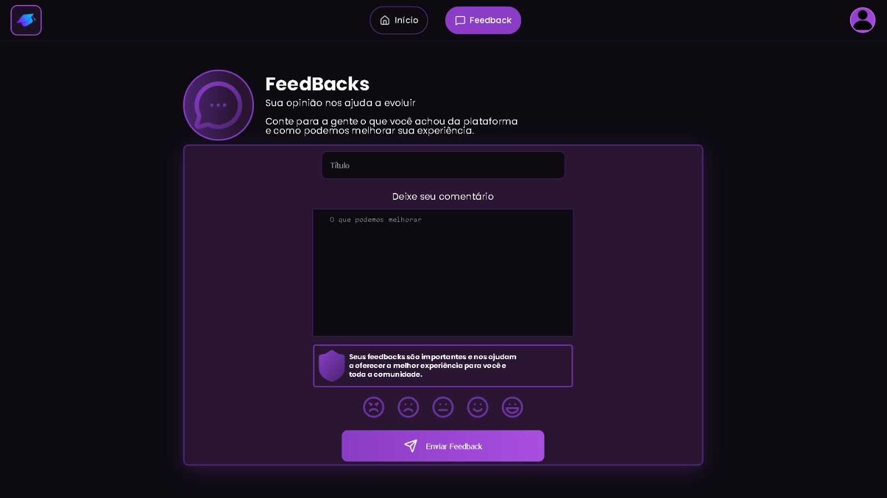
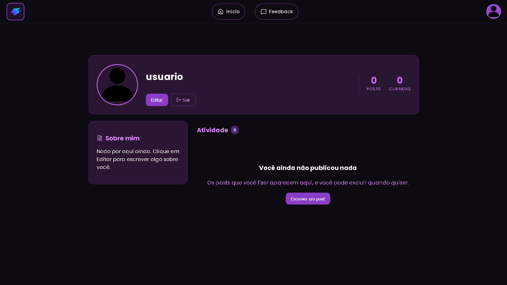

# DRM Connect

## 📌 Sobre o projeto

O **DRM Connect** é uma plataforma de interação entre alunos, desenvolvida para incentivar a troca de conhecimentos, a colaboração e a comunicação no ambiente escolar.

Por meio da plataforma, os estudantes podem criar publicações, compartilhar dúvidas sobre diferentes disciplinas, fazer perguntas e responder às questões de outros alunos.

Mais do que um espaço para tirar dúvidas, o DRM Connect busca promover a interação entre os estudantes, incentivando o aprendizado colaborativo e a construção de uma comunidade acadêmica mais conectada.

## 🛠️ Tecnologias utilizadas

- React 19
- JavaScript
- Vite
- Supabase
- React Router DOM
- Lucide React
- React Icons

## 🌐 Acesse o projeto

O DRM Connect está disponível online:

🔗 [Acessar DRM Connect](https://drmconnect.vercel.app)

## 🏢 Setores envolvidos

### 💻 Programação
Responsável pelo desenvolvimento, implementação e manutenção da plataforma.

### 🧪 Testes 
Responsável por testar as funcionalidades, identificar possíveis erros e verificar a qualidade do sistema.

### 📊 Análise de mercado
Responsável por estudar o público-alvo, identificar as necessidades dos alunos e analisar oportunidades para o projeto.

### 📢 Marketing
Responsável pela divulgação do DRM Connect, comunicação com o público e estratégias para alcançar novos usuários.

## 📸 Capturas de tela

### Página inicial

### Área de perguntas e respostas

### Área de feedback

### Perfil do usuário

---

**Desenvolvido pela equipe DRM.**
